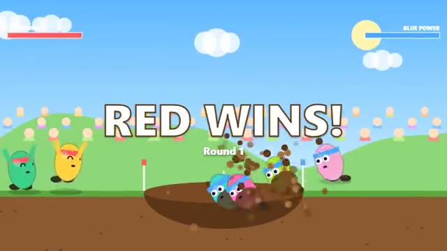

# Tug Team

Pull on the beat. Heave together. Drag them into the mud. A multiplayer starter game from [Multiplayer Agent](https://multiplayeragent.com): 2D, versus, 2–10 players, with bots that fill empty seats.

## How it plays

Two teams, one rope, a mud pit in between. Tap on the beat for a strong pull (off the beat is weak), keep a streak going for extra power, and when your whole team hits the same beat you HEAVE. Drag the flag past your line to win the round; best of 3.

**Controls:** Space, any key or click on the beat; on touch, tap anywhere.

## Make it yours in the Game Builder

Open the [Game Builder](https://multiplayeragent.com), choose **Start from a starter game** and pick Tug Team. It opens as version 1 in your studio, ready to play and publish. Then ask for changes, for example:

- Make it a tug of war over a lava pit with dragons
- Speed the beat up when the rope is near the middle
- Add a power-up drum that doubles your team's pull for 5 beats

## Run it yourself

1. Get a free publishable key (`pk_…`) at [multiplayeragent.com](https://multiplayeragent.com).
2. In `index.html`, put it in place of `pk_REPLACE_ME` in the `MP_CONNECT` block.
3. Open `index.html` in a browser. No build step and no server needed.

Without a key it still runs, offline against bots.

## How it is built

- One `index.html`. The comment at the top of the script maps the code and explains the multiplayer.
- **Host-run rules:** The host's browser adds up every pull, moves the rope and spots the heaves; if it leaves, the next player takes over.
- **Bots:** Bots fill both teams and tap close to the beat, but not perfectly.
- **Live sync:** Everyone hears the same beat and sees the same rope.
- **Leaderboard:** Matches won.
- `?attract` runs it offline with bots only. The preview video is recorded from it.

## License

MIT.
